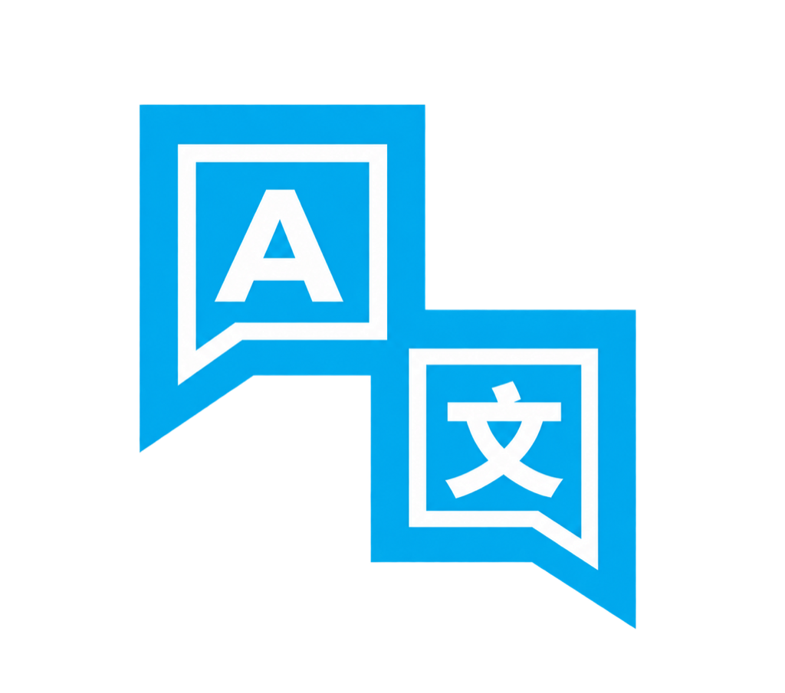

<h1 align="center">i18n Ally Community</h1>

<b>⚠️ This project is archived. Please use <a href="https://marketplace.visualstudio.com/items?itemName=lydanne.i18n-ally-next">i18n Ally Next</a> instead.</b>

English | <a href="https://github.com/junyou1998/i18n-ally-community/blob/main/README.zh-CN.md">简体中文</a> | <a href="https://github.com/junyou1998/i18n-ally-community/blob/main/README.zh-TW.md">繁體中文</a>

---

> ⚠️ **i18n Ally Community is deprecated and archived.**
>
> The reverse lookup features this extension introduced were merged into the upstream [i18n Ally Next](https://github.com/Lydanne/i18n-ally-next) on 2026-11-01 and ship in v3.0.16 and later, with identical features and keybindings.
>
> 👉 Please install [**i18n Ally Next**](https://marketplace.visualstudio.com/items?itemName=lydanne.i18n-ally-next) (`lydanne.i18n-ally-next`) and uninstall this extension. See [Migrating to i18n Ally Next](#migrating-to-i18n-ally-next) below.

## Why This Extension Was Published

[i18n Ally Next](https://github.com/Lydanne/i18n-ally-next) is great at going from a **key to its text**: inline annotations, hover previews, and locale editing. In practice, though, the opposite direction comes up constantly — **you only have the text, and you need the key and where it is used**:

- QA reports that a button label is wrong, with nothing but a screenshot.
- A design or product review asks for a piece of copy to change.
- You want to remove a key but aren't sure whether anything still uses it.

The usual workaround was a global text search through locale files, then a second search through the code with the key you found — even more tedious with nested keys, namespaces, or many locales.

These reverse lookup features were first built in a fork of i18n Ally Next and offered upstream. Since there was no clear timeline for an upstream merge and day-to-day work already depended on them, they were published on 2026-09-21 to the VS Code Marketplace as a separate `i18n-ally-community` extension. It used its own settings and command namespace, so it could run side by side with i18n Ally Next without conflicts.

## What It Added

On top of everything i18n Ally Next already does, it added three ways to go from **text back to keys**:

### 1. Search Translations by Value (Workspace)

`Cmd+Alt+Shift+F` (Windows / Linux: `Alt+Shift+F`), or click the globe-and-magnifier icon in the editor title bar.

- Type any text you see in the UI to instantly list matching keys across all locales.
- Each result shows the key, locale, text, and usage location (file and line); preview with the arrow keys.
- Press Enter to jump to the usage in your code with a yellow highlight, or to the locale definition if the key is unused.
- When there are too many results, slots are shared fairly across keys and the title notes that results are truncated.

### 2. Find Translation Value in File

`Cmd+Alt+F` (Windows / Linux: `Alt+F`)

- Finds keys matching the text within the current file only.
- All matches get a light yellow highlight and the current one a stronger outlined highlight, so you can see at a glance how many times the text appears and where.
- Pressing Esc restores your original cursor and scroll position.

### 3. Reverse Key References in Locale Files (CodeLens / Hover)

- Shows `X usages` above every key in JSON / YAML locale files; click to open all call sites.
- Unused keys show `0 usages`, making idle keys easy to clean up.
- The hover lists the first few usage locations with one-click navigation.

It also handled namespaced keys (including frameworks that use a non-`.` delimiter such as `ns:key`) and built a usage index so opening large locale files stays responsive.

## Why It Is Archived

The upstream maintainer merged these features on 2026-11-01 in [Lydanne/i18n-ally-next#37](https://github.com/Lydanne/i18n-ally-next/pull/37) and released them in [v3.0.16](https://github.com/Lydanne/i18n-ally-next/releases/tag/v3.0.16).

This extension existed to solve a real need until the features reached upstream. Now that they have, keeping a separate fork alive would only cause problems:

- Users would have to choose between two nearly identical extensions.
- Fixes and new features would be split across two codebases that are hard to keep in sync.
- With both installed, CodeLens, annotations, and hovers would all appear twice.

So this project is archived in favor of contributing upstream. Thanks to [Lydanne](https://github.com/Lydanne) for merging these features.

## Migrating to i18n Ally Next

1. Install [i18n Ally Next](https://marketplace.visualstudio.com/items?itemName=lydanne.i18n-ally-next) (`lydanne.i18n-ally-next`).
2. Uninstall i18n Ally Community.
3. Rename your project configuration to the upstream namespace:

   | Item | i18n Ally Community | i18n Ally Next |
   |---|---|---|
   | Settings prefix (`.vscode/settings.json`) | `i18n-ally-community.*` | `i18n-ally-next.*` |
   | Custom framework file | `.vscode/i18n-ally-community-custom-framework.yml` | `.vscode/i18n-ally-next-custom-framework.yml` |
   | Review file | `.vscode/i18n-ally-community-reviews.yml` | `.vscode/i18n-ally-next-reviews.yml` |

4. Keybindings stay the same — no changes needed.

> 💡 After updating to the final release (v0.2.1), the extension prompts you on startup to install i18n Ally Next and can install it and remove itself in one click. If i18n Ally Next is already installed, this extension stops running automatically to avoid duplicate features.

## ❤️ Credits

Thanks to [Lydanne](https://github.com/Lydanne) for maintaining i18n Ally Next and merging these features, and to every contributor across the i18n Ally family. This extension was originally inspired by [think2011/vscode-vue-i18n](https://github.com/think2011/vscode-vue-i18n), and Vue SFC support is provided by [kazupon/vue-i18n-locale-message](https://github.com/kazupon/vue-i18n-locale-message).

## 📄 License

Upstream copyright and license notices are preserved. See [`LICENSE`](./LICENSE).

[MIT](./LICENSE) © 2026 [junyou1998](https://github.com/junyou1998) | MIT © 2025-PRESENT [Lydanne](https://github.com/lydanne) | MIT © 2021-2024 [Lokalise](https://github.com/lokalise) | MIT © 2019-2020 [Anthony Fu](https://github.com/antfu) | MIT © 2018-2019 [think2011](https://github.com/think2011)
